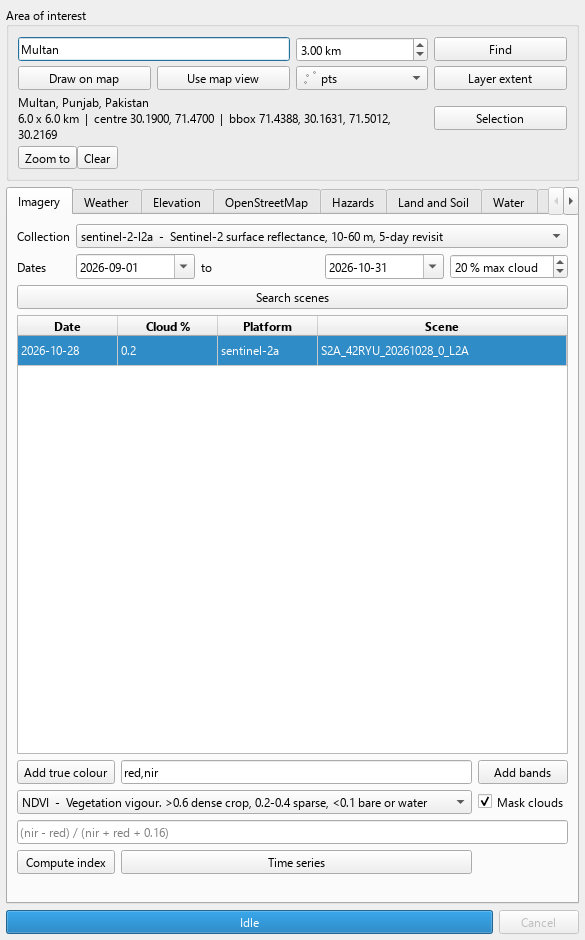
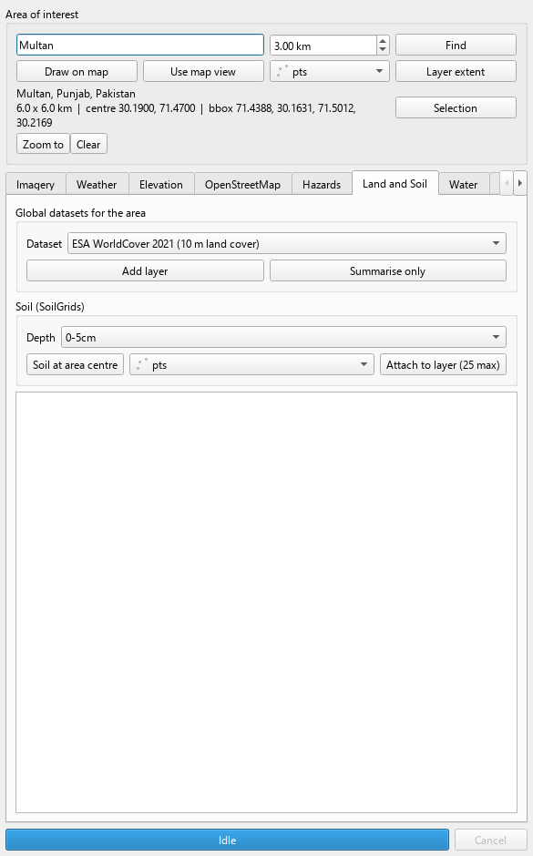
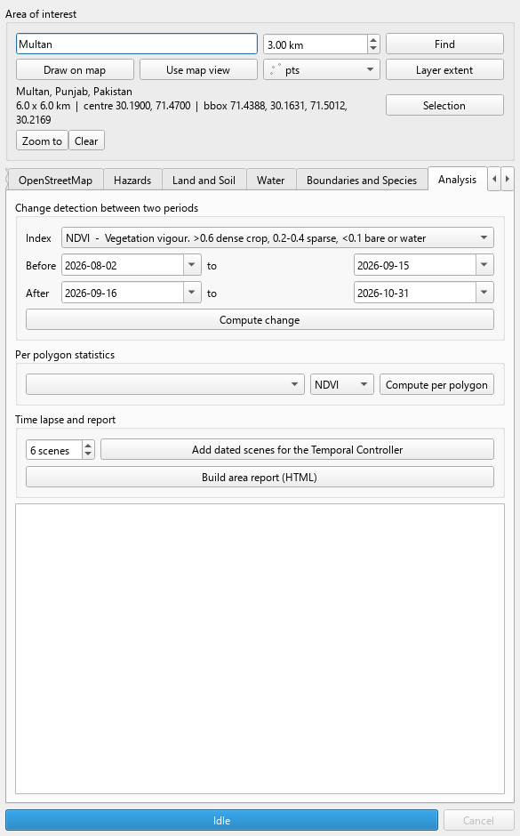
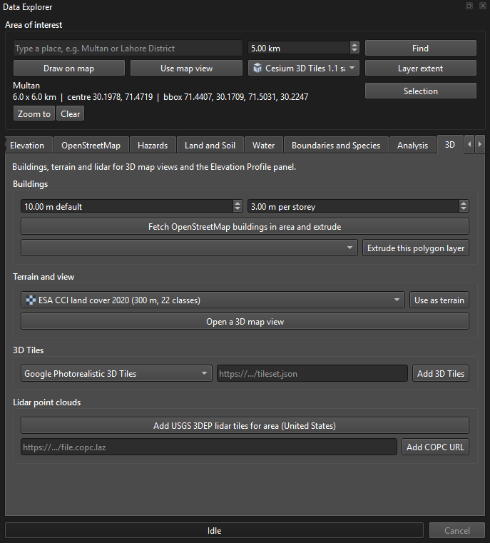
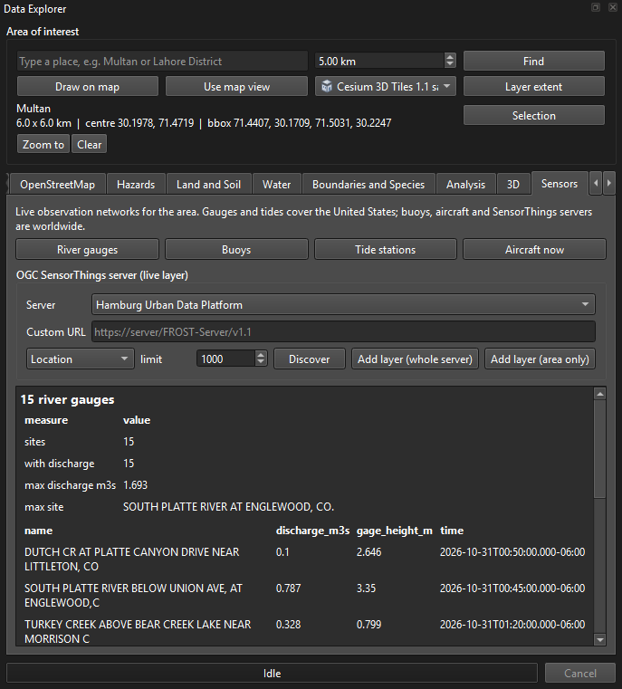
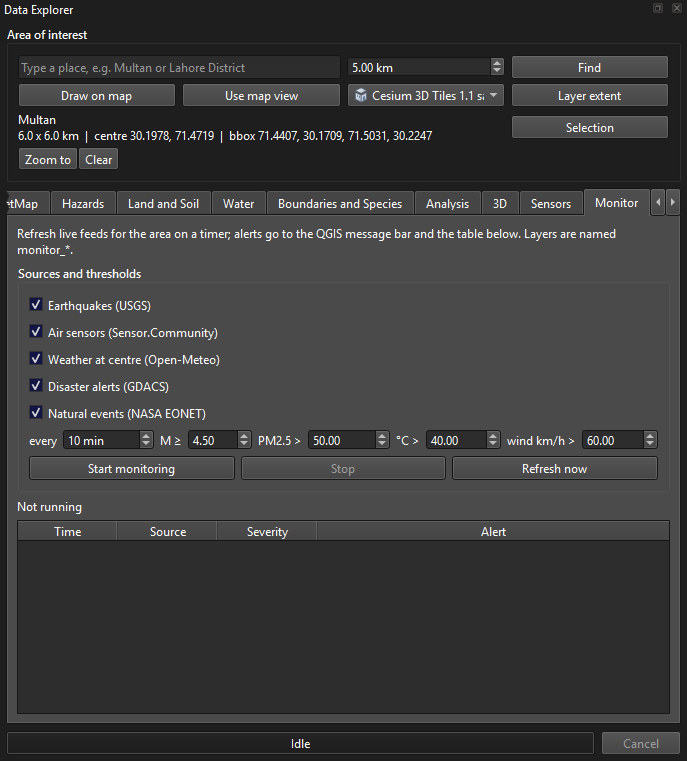
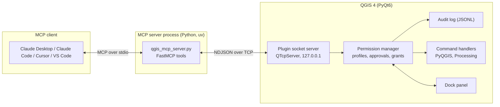

<div align="center">


# QGIS MCP

**A geospatial data toolbox for QGIS. The Data Explorer brings live satellite imagery, weather, elevation and OpenStreetMap data into your project with a few clicks, and a permission gated Model Context Protocol server lets Claude and other AI agents drive the same engine.**

*Explore the world's open data from inside QGIS, and let AI assist with full control in your hands.*

[](LICENSE)
[](https://qgis.org/)
[](https://www.python.org/)
[](https://modelcontextprotocol.io/)
[](CHANGELOG.md)
[](https://github.com/adilmunawar/qgis_mcp/stargazers)
[](#contributing)
[](https://github.com/adilmunawar/qgis_mcp/issues?q=is%3Aissue+is%3Aopen+label%3A%22good+first+issue%22)

</div>

---

## Data Explorer: open data in QGIS without any AI

You do not need Claude, an API key or an MCP client to use this toolbox. The **Data Explorer** is a dock panel inside QGIS. Pick an area, click a button, and the data arrives as a layer in your project.

<p align="center">
  
  
  
</p>
<p align="center">
  
  
  
</p>

**Open it**: the **Data Explorer** toolbar button (globe icon), `Plugins > QGIS MCP > Data Explorer`, or the `Open Data Explorer` button at the top of the QGIS MCP server panel. It also opens by itself the first time QGIS starts after an install or upgrade.

**Choose the area of interest** in any of five ways (until you do, the current map view is used): type a place name and a radius, press *Draw on map* and drag a rectangle, use the current map view, use a layer's extent, or use the selected features of a layer. The area is outlined in orange on the canvas and remembered between sessions.

**Then work through the tabs.** Every fetch runs in the background with a progress bar and a Cancel button, so QGIS never freezes.

| Tab | What you can do with clicks |
| --- | --- |
| Overview | The front door: your map view is the area until you choose one, and nine one click buttons give a quick look card (weather now, seven day forecast, elevation, land cover shares, population, topsoil), the latest clear Sentinel-2 image, NDVI, the land cover map, a DEM, surface temperature, the population grid, the last 30 days of rain and a PDF report |
| Imagery | Search Sentinel-2, Landsat or Sentinel-1 scenes by date and cloud cover; stream true colour or chosen bands; compute NDVI, EVI, SAVI, NDWI, MNDWI, NDMI, NDBI, NBR, BSI or your own band expression with cloud masking; build a time series of any index |
| Weather | Current conditions, a seven day forecast, air quality, daily history back to 1940, NASA POWER agro climatology; climate projections to 2050 from seven CMIP6 models; a seasonal outlook up to nine months; attach live weather fields to every feature of a layer |
| Elevation | Copernicus DEM 30 m for the area; slope, aspect, hillshade, roughness, TRI and TPI; elevation profiles across the area or along a selected road or river, with a chart |
| OpenStreetMap | Twenty one presets (hospitals, schools, roads, buildings, farmland, rivers, parks, power lines and more) or any custom tag, as points or full geometry |
| Hazards | USGS earthquakes by period and magnitude; NASA FIRMS active fires with a free key; NASA EONET natural events (storms, wildfires, floods, volcanoes, sea ice, dust) |
| Land and Soil | Twenty global rasters clipped to the area: ESA WorldCover, Esri land use, CCI land cover, forest map, surface water, four elevation models, MODIS land surface temperature, NDVI, leaf area, evapotranspiration, productivity, snow and burned area, biomass, biodiversity intactness, electrification and Meta's 30 m population grid, each with class shares or statistics; population of the area from WorldPop with an age pyramid; SoilGrids texture, pH, carbon and nitrogen at a point or attached to a layer |
| Water | GloFAS river discharge forecast and history, sea state and sea surface temperature, elevation at the area's centre and corners |
| Boundaries and Species | Administrative units of any country from geoBoundaries, GBIF species observations by taxon, Sensor.Community and OpenAQ air quality stations, GDACS disaster alerts |
| Analysis | Change detection between two periods with loss and gain shares, per polygon index statistics for any layer, dated scene series for the Temporal Controller, and a one click HTML or PDF area report with map, weather, elevation, land cover, soil and NDVI |
| 3D | OpenStreetMap buildings fetched and extruded by their height or storey tags, any footprint layer extruded, a DEM set as terrain, USGS lidar point clouds streamed as COPC (United States) or any COPC URL, Cesium 3D Tiles scenes (Google Photorealistic with a key, or any tileset URL), and a new 3D map view opened with one click |
| Sensors | USGS river gauges with discharge and stage, NOAA buoys with waves and wind, NOAA tide stations with water levels, aircraft positions right now from OpenSky, and any OGC SensorThings server (Hamburg, Dutch Samen Meten, or your own) as a live layer, whole server or area only |
| Monitor | Earthquakes, air sensors, weather, GDACS alerts and NASA events refreshed on a timer for the area, with thresholds you set; alerts land in the QGIS message bar and a table |
| Basemaps | OpenStreetMap, Esri imagery and topo, CARTO, OpenTopoMap, and NASA GIBS daily satellite layers by date |
| Sources | Every data source with its licence and whether it needs a key; paste keys here |
| Log | A timestamped record of everything the panel did |

Every layer the panel creates carries provenance metadata (source, query, time, licence) and fetched vectors are written to GeoPackage, so they survive saving the project. All sources are public and keyless except NASA FIRMS, OpenAQ and Google 3D Tiles, which need free keys.

## QGIS MCP server: an AI assistant for QGIS

QGIS MCP is a **QGIS AI assistant** built on the [Model Context Protocol](https://modelcontextprotocol.io/). It runs a small socket bridge inside QGIS and a standalone MCP server beside it, so an MCP client such as **Claude Desktop, Claude Code, Cursor or VS Code** can inspect and operate your QGIS session in plain language.

If you work with geospatial data, you can ask things like:

- "Load the district shapefile, filter it to Sugarcane parcels and tell me how many remain."
- "Which CRS does this unlabelled layer most likely use? Show me a render to confirm."
- "Run a buffer, clip it to the study area, and export the result to GeoPackage."
- "Check this layer for invalid geometries and duplicates, then summarise the problems."
- "Render the map and let me see it."
- "Find the least cloudy Sentinel-2 scene over Multan this month, compute NDVI for the farms, and tell me which fields look stressed."
- "Add the hospitals in this district from OpenStreetMap and attach today's temperature to each one."
- "Stream the 30 m DEM for the valley, derive a hillshade, and put it under the roads."

What sets it apart from a plain "run any code" bridge is **safety**. Every command carries a risk category (read, write, destructive, code). A **permission profile** decides whether each category is allowed, needs your approval, or is refused. Every command that reaches the dispatcher lands in an append only **audit log**, so you can always answer "what did the AI change?".

> This is a **Claude QGIS integration** and a general **Model Context Protocol GIS** server. Any client that speaks the Model Context Protocol can use it.

## Table of contents

- [Data Explorer: open data in QGIS without any AI](#data-explorer-open-data-in-qgis-without-any-ai)
- [Features](#features)
- [Architecture](#architecture)
- [Installation](#installation)
- [Connect your MCP client](#connect-your-mcp-client)
- [Tool reference](#tool-reference)
- [Permission profiles](#permission-profiles)
- [Wire protocol (NDJSON)](#wire-protocol-ndjson)
- [Running the tests](#running-the-tests)
- [Roadmap](#roadmap)
- [FAQ and troubleshooting](#faq-and-troubleshooting)
- [Contributing](#contributing)
- [Credits](#credits)
- [License and attribution](#license-and-attribution)

## Features

**Project**
- Create, load and save `.qgz` projects; read project info and set the project CRS.

**Layers**
- Add vector and raster layers, create in memory scratch layers with typed fields, remove or reload layers.
- Layer visibility, opacity, extent, field listing, CRS repair (`set_layer_crs`) and CRS detection (`detect_layer_crs`).
- Export vector layers to GeoPackage, GeoJSON, Shapefile or CSV.

**Analysis (PyQGIS automation without writing PyQGIS)**
- Exact feature counts, distinct values with counts, field statistics (min, max, sum, mean, median, stdev).
- SQL across project layers through virtual layers (`execute_sql`), grouped aggregates, geometry validity checks, duplicate finding.

**Editing**
- Add features from attributes and WKT, update values, delete features, add, rename and delete fields, build spatial indexes.
- Destructive edits **dry run by default** and report how many rows would change; they apply only with `confirm=true`.

**Raster**
- Band statistics and point sampling (`get_raster_statistics`, `sample_raster_values`).

**Processing**
- Discover algorithms, read their parameter help, and run any QGIS Processing algorithm.

**Rendering and layouts**
- Render the canvas to a file, or return it inline as an image the model can look at (`render_map_image`).
- List and export print layouts to PDF or image.

**Safety and permissions**
- Four permission profiles, a non blocking approval queue, temporary per command grants, an optional pairing token, a loopback only listener, and an opt in code execution tier.
- Unknown commands are treated as destructive, so a newly added command fails closed.

**Audit**
- JSONL audit trail of every dispatched command (verdict, client, status, truncated params, duration), readable through `get_audit_log`.

**Data Explorer dashboard (no AI required)**
- A dock panel inside QGIS: pick an area of interest by typing a place, drawing a rectangle on the map, using the current view, a layer's extent or its selected features.
- Sixteen tabs: Overview, Imagery, Weather, Elevation, OpenStreetMap, Hazards, Land and Soil, Water, Boundaries and Species, Analysis, 3D, Sensors, Monitor, Basemaps, Sources and a Log; every fetch runs as a background task with a progress bar and Cancel, so QGIS never freezes.
- Search Sentinel-2 or Landsat scenes, stream true colour or chosen bands, compute NDVI and other indices with one click, build index time series, add DEMs and derive hillshade or slope, fetch OSM presets such as hospitals, roads, buildings and farmland, pull weather for the area centre or attach it to every feature of a layer.
- Open it from the QGIS MCP toolbar button menu or `Plugins > QGIS MCP > Data Explorer`.

**Live data (keyless public sources)**
- **Satellite imagery**: search Sentinel-2, Landsat 8/9 and Sentinel-1 scenes over any area through STAC and stream them as cloud optimised GeoTIFFs, nothing downloaded until rendered.
- **Spectral indices**: NDVI, EVI, SAVI, NDWI, MNDWI, NDMI, NDBI, NBR, BSI or a custom band expression, cloud masked with the Sentinel-2 scene classification, computed only over your area, styled on arrival, with class breakdowns and per scene time series.
- **Elevation**: Copernicus DEM 30 m mosaics on demand, plus slope, aspect, hillshade, roughness, TRI and TPI.
- **Weather and climate**: Open-Meteo current conditions, forecasts, air quality and an hourly archive back to 1940; NASA POWER daily agro climatology since 1981; weather fields attached to every feature of a layer.
- **Places and OpenStreetMap**: Nominatim geocoding both ways, administrative boundaries as layers, any OSM feature type by tag through Overpass.
- **Hazards**: USGS earthquakes for the last hour to month, NASA FIRMS active fires (free key), NASA EONET natural events with tracks.
- **Basemaps**: OSM, Esri imagery and topo, CARTO, OpenTopoMap, and NASA GIBS daily satellite layers (true colour, NDVI, fires, snow, night lights, rainfall) selectable by date.
- **Land and soil**: twenty global rasters clipped to the area (ESA WorldCover, Esri land use, CCI land cover, ALOS forest map, JRC surface water, NASADEM, ALOS and Copernicus DEMs, 3DEP height above ground, MODIS land surface temperature, NDVI, leaf area, evapotranspiration, productivity, snow cover and burned area, harmonised biomass, Biodiversity Intactness Index, HREA electrification, Meta population density) with class shares in km² or statistics in physical units; SoilGrids texture, pH, carbon, nitrogen and water retention at a point or attached to features.
- **Climate**: seven CMIP6 HighResMIP models to 2050 with ensemble means and decade trends; seasonal outlooks up to nine months with member spread.
- **3D**: building footprints extruded by height or storey tags, any DEM as terrain, USGS 3DEP lidar as streamed COPC point clouds, Cesium 3D Tiles (Google Photorealistic with a key or any tileset), 3D map views opened on request; elevation profiles with charts along any line.
- **Sensor networks**: USGS river gauges, NOAA buoys and tide stations, OpenSky aircraft positions, and any OGC SensorThings server as a live layer through the native QGIS provider.
- **Population**: WorldPop totals and age and sex pyramids for any area, cross checked against Meta's 30 m grid.
- **Live monitor**: earthquakes, air sensors, weather, GDACS alerts and NASA EONET events refreshed on a timer for an area, with threshold alerts in the message bar and the audit log.
- **Water**: GloFAS river discharge forecast and history, sea state and sea surface temperature, elevation at any points.
- **Boundaries, species and sensors**: geoBoundaries administrative units for every country, GBIF species observations by taxon, Sensor.Community and OpenAQ (free key) air quality stations, GDACS disaster alerts.
- **Analysis workflows**: change detection between two periods with loss and gain classes, per polygon index statistics, dated scene series for the Temporal Controller, and an HTML or PDF area report.
- Every fetched layer carries provenance metadata: source, query, date and licence.

**Panel**
- A QGIS dock panel for server status, live counters, activity, approvals, profile switching, tokens and a one click "Copy MCP client config" button.

## Architecture



Two components:

1. **QGIS plugin** ([`qgis_mcp_plugin/`](qgis_mcp_plugin/)) runs a socket server inside QGIS, authenticates clients, applies the permission profile, writes the audit log and executes commands on the GUI thread.
2. **MCP server** ([`src/qgis_mcp/qgis_mcp_server.py`](src/qgis_mcp/qgis_mcp_server.py)) speaks MCP to your client over stdio and forwards each tool call to the plugin.

Approvals are **non blocking**: a command awaiting approval parks its reply instead of opening a modal dialog (which would freeze the very GUI thread the server runs on).

## Installation

### Prerequisites

- **QGIS 4.x** (PyQt6). Developed and tested against QGIS 4.2.x. `metadata.txt` declares `qgisMinimumVersion=3.22` and `qgisMaximumVersion=4.99`, with `supportsQt6=True`.
- **Python 3.12 or newer** for the MCP server (`requires-python = ">=3.12"`).
- [**uv**](https://docs.astral.sh/uv/getting-started/installation/) package manager.
- An MCP client (Claude Desktop, Claude Code, Cursor, VS Code, ...).

Install `uv`:

```bash
# macOS
brew install uv

# Windows (PowerShell)
powershell -ExecutionPolicy ByPass -c "irm https://astral.sh/uv/install.ps1 | iex"

# Linux
curl -LsSf https://astral.sh/uv/install.sh | sh
```

### 1. Get the code

```bash
git clone https://github.com/adilmunawar/qgis_mcp.git
cd qgis_mcp
```

### 2. Install the QGIS plugin

Copy (or symlink) the [`qgis_mcp_plugin`](qgis_mcp_plugin/) folder into your **QGIS 4 profile's** plugin directory. You can find the profile in QGIS via `Settings` > `User Profiles` > `Open Active Profile Folder`, then `python/plugins`.

| OS | QGIS 4 plugin folder |
| --- | --- |
| Windows | `%APPDATA%\QGIS\QGIS4\profiles\default\python\plugins` |
| macOS | `~/Library/Application Support/QGIS/QGIS4/profiles/default/python/plugins` |
| Linux | `~/.local/share/QGIS/QGIS4/profiles/default/python/plugins` |

Windows (PowerShell), symlink for development:

```powershell
$src = "$(pwd)\qgis_mcp_plugin"
$dst = "$env:APPDATA\QGIS\QGIS4\profiles\default\python\plugins\qgis_mcp_plugin"
New-Item -ItemType SymbolicLink -Path $dst -Target $src
```

macOS and Linux:

```bash
# macOS
ln -s "$(pwd)/qgis_mcp_plugin" "$HOME/Library/Application Support/QGIS/QGIS4/profiles/default/python/plugins/qgis_mcp_plugin"
# Linux
ln -s "$(pwd)/qgis_mcp_plugin" "$HOME/.local/share/QGIS/QGIS4/profiles/default/python/plugins/qgis_mcp_plugin"
```

> Using QGIS 3.x? The profile folder is `QGIS3` instead of `QGIS4`.

Restart QGIS, open `Plugins` > `Manage and Install Plugins`, search for **QGIS MCP** and tick it.

### 3. Start the bridge

1. In QGIS, open `Plugins` > `QGIS MCP` to show the dock panel.
2. Click **Start Server** (default `127.0.0.1:9876`).
3. Choose a permission profile. If you enable the pairing token requirement, copy the token from the panel.

The panel's **Copy MCP client config** button produces a ready made snippet for your client.

## Connect your MCP client

The MCP server reads its settings from environment variables:

| Variable | Default | Meaning |
| --- | --- | --- |
| `QGIS_MCP_HOST` | `127.0.0.1` | Host of the QGIS plugin socket |
| `QGIS_MCP_PORT` | `9876` | Port of the QGIS plugin socket |
| `QGIS_MCP_TOKEN` | *(empty)* | Pairing token shown in the QGIS MCP panel, when required |
| `QGIS_MCP_TIMEOUT` | `300.0` | Timeout per request in seconds |
| `QGIS_MCP_CLIENT_NAME` | `claude-mcp` | Name shown in the panel and audit log |

Replace `/ABSOLUTE/PATH/TO/qgis_mcp` with your clone path (on Windows use forward slashes or escaped backslashes).

### Claude Desktop

`Claude` > `Settings` > `Developer` > `Edit Config`, then edit `claude_desktop_config.json`:

```json
{
  "mcpServers": {
    "qgis": {
      "command": "uv",
      "args": ["--directory", "/ABSOLUTE/PATH/TO/qgis_mcp/src/qgis_mcp", "run", "qgis_mcp_server.py"],
      "env": {
        "QGIS_MCP_HOST": "127.0.0.1",
        "QGIS_MCP_PORT": "9876",
        "QGIS_MCP_TOKEN": "paste-token-from-panel-if-required"
      }
    }
  }
}
```

### Claude Code

```bash
claude mcp add qgis \
  --env QGIS_MCP_HOST=127.0.0.1 --env QGIS_MCP_PORT=9876 --env QGIS_MCP_TOKEN=your-token \
  -- uv --directory /ABSOLUTE/PATH/TO/qgis_mcp/src/qgis_mcp run qgis_mcp_server.py
```

Or use a project scoped `.mcp.json`:

```json
{
  "mcpServers": {
    "qgis": {
      "command": "uv",
      "args": ["--directory", "/ABSOLUTE/PATH/TO/qgis_mcp/src/qgis_mcp", "run", "qgis_mcp_server.py"],
      "env": { "QGIS_MCP_PORT": "9876", "QGIS_MCP_TOKEN": "your-token" }
    }
  }
}
```

### Cursor

`.cursor/mcp.json` (project) or `~/.cursor/mcp.json` (global):

```json
{
  "mcpServers": {
    "qgis": {
      "command": "uv",
      "args": ["--directory", "/ABSOLUTE/PATH/TO/qgis_mcp/src/qgis_mcp", "run", "qgis_mcp_server.py"],
      "env": { "QGIS_MCP_HOST": "127.0.0.1", "QGIS_MCP_PORT": "9876", "QGIS_MCP_TOKEN": "your-token" }
    }
  }
}
```

### VS Code

`.vscode/mcp.json` (the top level key is `servers`):

```json
{
  "servers": {
    "qgis": {
      "type": "stdio",
      "command": "uv",
      "args": ["--directory", "/ABSOLUTE/PATH/TO/qgis_mcp/src/qgis_mcp", "run", "qgis_mcp_server.py"],
      "env": { "QGIS_MCP_HOST": "127.0.0.1", "QGIS_MCP_PORT": "9876", "QGIS_MCP_TOKEN": "your-token" }
    }
  }
}
```

> Never commit a real token. Use your client's secret or input-variable mechanism where available.

### Example prompt

```text
You have access to QGIS tools. Please:
1. Ping to check the connection.
2. Create a new project at "C:/data/demo.qgz".
3. Load "C:/data/districts.shp" as "Districts".
4. Count features where "crop_class" = 'Sugarcane', then filter the layer to them.
5. Check geometry validity and report any problems.
6. Render the map so I can see it, then save the project.
```

## Tool reference

The MCP server exposes **118 tools**. The **Risk** column is the category from [`permissions.py`](qgis_mcp_plugin/permissions.py); it decides what each [permission profile](#permission-profiles) does with the tool. `render_map_image` is a wrapper on the client side over the plugin command `render_map_base64` (read).


#### Diagnostics and audit

| Tool | Purpose | Risk |
| --- | --- | --- |
| `ping` | Check connectivity to the QGIS plugin. | `read` |
| `get_qgis_info` | Get QGIS version, profile folder and Python version. | `read` |
| `get_server_info` | Get plugin version, protocol version, and which commands are available. | `read` |
| `get_audit_log` | Read the audit trail of commands the bridge has run. | `read` |

#### Project

| Tool | Purpose | Risk |
| --- | --- | --- |
| `load_project` | Load a QGIS project from the specified path. | `destructive` |
| `create_new_project` | Create a new project and save it. Clears the currently loaded project. | `destructive` |
| `get_project_info` | Get current project information, including its layers. | `read` |
| `save_project` | Save the project to the given path, or to its current path if omitted. | `destructive` |
| `set_project_crs` | Set the project CRS, e.g. 'EPSG:4326'. | `write` |

#### Layers

| Tool | Purpose | Risk |
| --- | --- | --- |
| `add_vector_layer` | Add a vector layer to the project. | `write` |
| `add_raster_layer` | Add a raster layer to the project. | `write` |
| `create_memory_layer` | Create an in memory scratch layer. | `write` |
| `get_layers` | Retrieve all layers in the current project with their metadata. | `read` |
| `remove_layer` | Remove a layer from the project by its ID. | `destructive` |
| `reload_layer` | Reload a layer from its source, picking up changes made on disk. | `write` |
| `set_layer_visibility` | Show or hide a layer in the layer tree. | `write` |
| `set_layer_opacity` | Set layer opacity, 0.0 (transparent) to 1.0 (opaque). | `write` |
| `set_layer_crs` | Declare a layer's CRS, e.g. 'EPSG:32642'. | `write` |
| `get_layer_fields` | List the attribute fields of a vector layer, with types. | `read` |
| `get_layer_extent` | Get a layer's bounding box and CRS. | `read` |
| `export_layer` | Export a vector layer to a file. Drivers: GPKG, GeoJSON, ESRI Shapefile, CSV. | `write` |
| `zoom_to_layer` | Zoom the map canvas to the extent of a specified layer. | `write` |

#### Styling

| Tool | Purpose | Risk |
| --- | --- | --- |
| `set_layer_style` | Apply a QGIS style (.qml) file to a layer. | `write` |
| `save_layer_style` | Save a layer's current style to a .qml file. | `write` |

#### Features, selection and filters

| Tool | Purpose | Risk |
| --- | --- | --- |
| `get_layer_features` | Retrieve features from a vector layer, optionally filtered. | `read` |
| `count_features` | Count features exactly, optionally matching a QGIS expression. | `read` |
| `get_unique_values` | List a field's distinct values with occurrence counts, most common first. | `read` |
| `get_field_statistics` | Compute count, distinct, missing, min, max, sum, mean, median and stdev. | `read` |
| `get_layer_filter` | Get the layer's current subset filter expression, if any. | `read` |
| `set_layer_filter` | Filter a layer to features matching a QGIS expression. | `write` |
| `clear_layer_filter` | Remove a layer's subset filter, restoring all features. | `write` |
| `select_features_by_expression` | Select features matching a QGIS expression, and report how many matched. | `write` |
| `get_selected_features` | Retrieve the currently selected features of a vector layer. | `read` |
| `clear_selection` | Clear the selection on one layer, or on all vector layers if omitted. | `write` |
| `zoom_to_selection` | Zoom the canvas to the selected features of a layer. | `write` |
| `add_features` | Add features to a writable layer. | `write` |
| `update_features` | Set field values on matching features. DESTRUCTIVE. | `destructive` |
| `delete_features` | Delete features matching an expression. DESTRUCTIVE. | `destructive` |

#### Schema

| Tool | Purpose | Risk |
| --- | --- | --- |
| `add_field` | Add an attribute field (string, integer, longlong, double, boolean, date, datetime). | `write` |
| `rename_field` | Rename an attribute field. | `write` |
| `delete_field` | Drop a field and every value in it. DESTRUCTIVE; dry runs unless confirmed. | `destructive` |
| `create_spatial_index` | Build a spatial index, which speeds up rendering and spatial queries. | `write` |

#### Analysis and data quality

| Tool | Purpose | Risk |
| --- | --- | --- |
| `execute_sql` | Run SQL across project layers, joining and aggregating them. | `read` |
| `group_statistics` | Aggregate a field grouped by another. | `read` |
| `check_geometry_validity` | Report invalid or empty geometries, with the reason for each. | `read` |
| `find_duplicates` | Find duplicates by attribute values, or by geometry if fields is omitted. | `read` |
| `detect_layer_crs` | Infer a layer's true CRS from its coordinates when it is missing or wrong. | `read` |

#### Raster

| Tool | Purpose | Risk |
| --- | --- | --- |
| `get_raster_statistics` | Band minimum, maximum, mean, standard deviation, range and sum. | `read` |
| `sample_raster_values` | Read raster values at points. | `read` |

#### Processing

| Tool | Purpose | Risk |
| --- | --- | --- |
| `list_processing_algorithms` | List available processing algorithms, optionally filtered by substring. | `read` |
| `get_processing_algorithm_help` | Get the help text and parameter list for a processing algorithm. | `read` |
| `execute_processing` | Execute a processing algorithm with the given parameters. | `destructive` |

#### Canvas, rendering and layouts

| Tool | Purpose | Risk |
| --- | --- | --- |
| `get_canvas_state` | Get the map canvas extent, scale, rotation, CRS and size. | `read` |
| `set_canvas_extent` | Set the map canvas extent, in project CRS coordinates. | `write` |
| `render_map` | Render the map to an image file. | `write` |
| `render_map_image` | Render the current map and return it as an image you can actually look at. | `read` |
| `list_layouts` | List the print layouts defined in the current project. | `read` |
| `export_layout` | Export a print layout to PDF or an image, chosen by the file extension. | `write` |

#### Code

| Tool | Purpose | Risk |
| --- | --- | --- |
| `execute_code` | Execute arbitrary PyQGIS code inside QGIS. | `code` |

#### Live data: discovery and places

Every live data tool takes an `aoi` that can be `{"place": "Multan"}`, `{"place": "Multan", "radius_km": 15}`, `{"bbox": [west, south, east, north]}`, `{"layer_id": "..."}`, `{"layer_id": "...", "selected": true}`, `{"canvas": true}`, `{"point": [lon, lat], "radius_km": 10}` or `{"wkt": "...", "crs": "EPSG:4326"}`.

| Tool | Purpose | Risk |
| --- | --- | --- |
| `list_data_sources` | Catalogue of live sources by category with licence and key requirements. | `read` |
| `resolve_aoi` | Preview how an area of interest will be interpreted. | `read` |
| `geocode` | Place name to coordinates and bounding box (Nominatim). | `read` |
| `reverse_geocode` | Coordinates to a place description. | `read` |
| `add_place_marker` | Add a geocoded place, with its boundary polygon when known, as a layer. | `write` |
| `set_data_source_key` | Store an API key for a source that needs one (never echoed back). | `write` |

#### Live data: satellite imagery and elevation

| Tool | Purpose | Risk |
| --- | --- | --- |
| `search_imagery` | Find Sentinel-2, Landsat or Sentinel-1 scenes over an area, least cloudy first. | `read` |
| `add_imagery` | Stream a scene's bands into the project as cloud optimised GeoTIFF layers. | `write` |
| `compute_spectral_index` | NDVI, NDWI, NBR and more, or a custom expression, cloud masked, over an area. | `write` |
| `get_index_time_series` | Mean index per scene across a date range, with the change from first to last scene. | `read` |
| `add_dem` | Stream Copernicus DEM 30 m covering an area as one layer. | `write` |
| `derive_terrain` | Slope, aspect, hillshade, roughness, TRI or TPI from a DEM layer. | `write` |

#### Live data: weather and climate

| Tool | Purpose | Risk |
| --- | --- | --- |
| `get_weather` | Current conditions, a daily forecast, or air quality for a point or area. | `read` |
| `get_weather_history` | Historical daily weather since 1940 with per variable summaries. | `read` |
| `get_climate_series` | NASA POWER daily agro climatology since 1981. | `read` |
| `attach_weather_to_layer` | Add weather fields to every feature of a layer, sampled at its centroid. | `write` |

#### Live data: basemaps, OpenStreetMap and hazards

| Tool | Purpose | Risk |
| --- | --- | --- |
| `list_basemaps` | Available basemaps, including NASA GIBS daily satellite layers. | `read` |
| `add_basemap` | Add a tiled basemap underneath the other layers; GIBS layers take a date. | `write` |
| `fetch_osm_features` | OpenStreetMap features by tag inside an area, as point or full geometry layers. | `write` |
| `fetch_earthquakes` | USGS earthquakes for the last hour to month, filtered by area and magnitude. | `write` |
| `fetch_active_fires` | NASA FIRMS active fire detections for the last 1 to 10 days (free key). | `write` |

#### Toolbox: land, soil and water

| Tool | Purpose | Risk |
| --- | --- | --- |
| `list_datasets` | The nineteen global rasters the toolbox can add, by category, with units and licences. | `read` |
| `add_dataset` | Add a global raster clipped to the area in physical units, styled, with class shares or statistics. | `write` |
| `summarise_land_cover` | Class shares, statistics or wet fractions for a dataset over the area, without adding a layer. | `read` |
| `get_soil_properties` | SoilGrids texture, pH, carbon, nitrogen and more by depth, with the USDA texture class. | `read` |
| `attach_soil_to_layer` | Add topsoil properties to features at their centroids. | `write` |
| `get_river_discharge` | GloFAS river discharge forecast and recent history. | `read` |
| `get_marine_conditions` | Waves, swell, sea surface temperature and currents. | `read` |
| `get_elevation` | Elevation at up to 100 points or the area centre. | `read` |

#### Toolbox: boundaries, species, sensors and alerts

| Tool | Purpose | Risk |
| --- | --- | --- |
| `add_admin_boundaries` | A country's administrative units from geoBoundaries, optionally only those touching the area. | `write` |
| `fetch_species_occurrences` | GBIF species records in the area by taxon, with the most recorded species. | `write` |
| `fetch_air_sensors` | Live PM2.5, PM10, temperature and humidity from citizen sensor stations. | `write` |
| `fetch_disaster_alerts` | Current GDACS alerts worldwide or in the area, by type and level. | `write` |
| `fetch_natural_events` | NASA EONET natural events with latest position, magnitude and track length. | `write` |
| `fetch_air_quality_stations` | OpenAQ monitors within 25 km with latest readings (free key). | `write` |

#### Toolbox: analysis workflows

| Tool | Purpose | Risk |
| --- | --- | --- |
| `compute_index_change` | Index difference between two periods as a styled raster with loss and gain shares. | `write` |
| `zonal_index_statistics` | Mean, min and max of an index per polygon, written to the layer. | `write` |
| `add_imagery_series` | Dated scenes with time ranges for the Temporal Controller. | `write` |
| `export_area_report` | HTML or PDF briefing: map, weather, elevation, land cover, soil, NDVI. | `write` |

#### Toolbox: climate, profiles, 3D and monitor

| Tool | Purpose | Risk |
| --- | --- | --- |
| `get_climate_projection` | Yearly temperature and rainfall to 2050 from seven CMIP6 models, with the decade trend. | `read` |
| `get_seasonal_forecast` | Ensemble outlook up to nine months, daily and weekly, with member spread. | `read` |
| `get_elevation_profile` | Elevation along a line, layer feature, points or area transect; gain, loss, grade and a chart. | `read` |
| `make_3d_buildings` | Extrude a footprint layer by height or storey tags for 3D views and profiles. | `write` |
| `add_3d_buildings` | Fetch OpenStreetMap buildings in a small area and extrude them. | `write` |
| `set_terrain` | Use a DEM layer as the project's 3D terrain and profile ground. | `write` |
| `add_point_cloud` | USGS 3DEP lidar tiles for the area (United States) or any COPC URL, streamed. | `write` |
| `open_3d_view` | Open a new 3D map view in the QGIS window; needs confirm, since it can crash QGIS without a real GPU. | `destructive` |
| `start_live_monitor` | Refresh feeds for the area on a timer and raise threshold alerts. | `write` |
| `stop_live_monitor` | Stop the live monitor. | `write` |
| `get_live_monitor_status` | Monitor configuration, counts per source and recent alerts. | `read` |

#### Toolbox: sensor networks, population and 3D Tiles

| Tool | Purpose | Risk |
| --- | --- | --- |
| `fetch_river_gauges` | USGS stream gauges with current discharge, stage and water temperature (United States). | `write` |
| `fetch_buoys` | NOAA buoys and coastal stations with the latest wind, waves, pressure and sea temperature. | `write` |
| `fetch_tide_stations` | NOAA tide stations with the latest water level (United States coasts). | `write` |
| `fetch_aircraft` | Aircraft positions right now from the OpenSky Network. | `write` |
| `list_sensorthings_servers` | Verified public OGC SensorThings servers and mappable entity sets. | `read` |
| `discover_sensorthings` | Entity sets, location count and a sample from a SensorThings server. | `read` |
| `add_sensorthings_layer` | A SensorThings entity set as a live layer, optionally filtered to the area. | `write` |
| `estimate_population` | People in the area from WorldPop and Meta's 30 m grid, with an optional age pyramid. | `read` |
| `add_3d_tiles` | Cesium 3D Tiles scene: Google Photorealistic (key), the Cesium sample, or any tileset URL. | `write` |


> Commands missing from the permission table are treated as `destructive`, so new commands fail closed.

## Permission profiles

| Profile | read | write | destructive | code | Intended use |
| --- | --- | --- | --- | --- | --- |
| **Read only** | allow | deny | deny | deny | Inspect only |
| **Standard** (default) | allow | allow | approve | deny | Everyday editing; deletions and overwrites ask first |
| **Full** | allow | allow | approve | approve | Everything available; destructive actions and code ask first |
| **Master Control** | allow | allow | allow | allow | Unrestricted; nothing is refused or asks |

- **approve** parks the command in the panel's approval queue until you accept, reject, or it times out (60 s by default).
- **Temporary grants** let you allow one specific command for a number of minutes without changing profile.
- `ping` and `get_server_info` are always allowed so a client can discover why it was refused.
- **Pairing token** (optional): when required, clients must send a `hello` with the token before anything but `ping`.
- The listener binds to `127.0.0.1`. Treat Master Control and `execute_code` as full control of QGIS's Python on your machine.
- Every decision is written to `qgis_mcp_audit.jsonl` in the QGIS settings directory.

## Wire protocol (NDJSON)

The plugin and MCP server talk newline delimited JSON over TCP (protocol version 3), one document per line in both directions:

```text
request   {"type": "<command>", "params": {...}, "id": <optional>}\n
response  {"status": "success" | "error", "result": ..., "id": <echoed>}\n
```

- The MCP server first sends `{"type": "hello", "params": {"client": "<name>", "token": "<token>"}}`. The reply reports the protocol version and whether a token is required.
- `ping` answers before authentication; everything else requires `hello` when a token is enforced.
- Errors carry `error_type` (for example `Unauthorized`) and a `message`.
- Bare JSON documents without a trailing newline from older v1 clients are still accepted.
- Buffers per client are capped at 32 MB.

## Running the tests

The headless tests run inside QGIS's own Python, with no GUI. On Windows with QGIS 4.2.2:

```bat
"C:\Program Files\QGIS 4.2.2\bin\python-qgis.bat" tests\test_plugin_headless.py
"C:\Program Files\QGIS 4.2.2\bin\python-qgis.bat" tests\test_permissions_headless.py
"C:\Program Files\QGIS 4.2.2\bin\python-qgis.bat" tests\test_data_commands_headless.py
"C:\Program Files\QGIS 4.2.2\bin\python-qgis.bat" tests\test_lifecycle_headless.py
"C:\Program Files\QGIS 4.2.2\bin\python-qgis.bat" tests\test_live_data_headless.py
"C:\Program Files\QGIS 4.2.2\bin\python-qgis.bat" tests\test_toolbox_headless.py
"C:\Program Files\QGIS 4.2.2\bin\python-qgis.bat" tests\test_explorer_headless.py
"C:\Program Files\QGIS 4.2.2\bin\python-qgis.bat" tests\test_advanced_headless.py
"C:\Program Files\QGIS 4.2.2\bin\python-qgis.bat" tests\test_sensors_headless.py
```

The live data, toolbox, advanced, sensors and explorer suites import the plugin from the checkout and stub every HTTP call, so they need no network; add `--online` to the explorer suite for a real network scenario. The four older suites import the plugin from the QGIS 4 profile (`%APPDATA%\QGIS\QGIS4\profiles\default\python\plugins`), so copy the plugin there first. Adjust the QGIS path for your install location. Together the suites run about 500 checks.

## Roadmap

Shipped in 4.4.0:

- [x] **Sensor networks**: USGS river gauges, NOAA buoys and tides, OpenSky aircraft, any OGC SensorThings server as a live layer
- [x] **Population**: WorldPop totals and age pyramids, Meta's 30 m population grid as a dataset
- [x] **3D Tiles**: Google Photorealistic 3D Tiles with a key, or any Cesium tileset

Shipped in 4.3.0:

- [x] **Refreshing layers**: a live monitor that refreshes earthquakes, sensors, weather, alerts and events on a timer with threshold notifications
- [x] **3D**: OpenStreetMap buildings extruded by height, DEM terrain, USGS lidar point clouds as COPC, 3D views on request
- [x] **Fifteen more global rasters**: CCI land cover, forest, three more DEMs, MODIS temperature, NDVI, leaf area, evapotranspiration, productivity, snow, burned area, biomass, biodiversity, electrification
- [x] **Climate**: CMIP6 projections to 2050 and seasonal outlooks; **profiles**: elevation along any line; **PDF reports**
- [x] **More feeds**: NASA EONET natural events, OpenAQ monitors (key)

Shipped in 4.2.0:

- [x] **Data Explorer without AI**: twelve tabs covering every source below, with background tasks
- [x] **Land and soil**: ESA WorldCover, Esri land use, JRC surface water, NASADEM, SoilGrids
- [x] **Water**: GloFAS river discharge, marine conditions, point elevation
- [x] **Boundaries, species, sensors, alerts**: geoBoundaries, GBIF, Sensor.Community, GDACS
- [x] **Analysis**: change detection, per polygon statistics, temporal series, HTML area report

Shipped in 4.1.0:

- [x] **Satellite imagery**: Sentinel-2, Landsat and Sentinel-1 discovery and streaming through STAC
- [x] **Spectral indices**: NDVI and eight more, custom expressions, cloud masking, time series
- [x] **Weather and climate**: Open-Meteo and NASA POWER, attached to layers
- [x] **Geocoding and OpenStreetMap**: Nominatim and Overpass
- [x] **Elevation**: Copernicus DEM and terrain derivatives
- [x] **Hazards and basemaps**: USGS earthquakes, NASA FIRMS, NASA GIBS daily imagery
- [x] **Data Explorer dashboard**: the same engine driven by clicks inside QGIS, with background tasks

Next:

- [ ] **More SensorThings presets** and OGC API Features and EDR servers, AIS ships
- [ ] **Overture buildings** and scene export from 3D views
- [ ] **More sources**: Copernicus Data Space (Sentinel-5P, Sentinel-3), FAO WaPOR, CHIRPS rainfall, Sentinel-1 RTC backscatter, GHSL built up grids

Track progress in the [CHANGELOG](CHANGELOG.md) and the issue tracker.

## FAQ and troubleshooting

**The tools do not appear in my client.**
Check that your client config points at `src/qgis_mcp` with `uv --directory ... run qgis_mcp_server.py`, then restart the client. Run the command by hand to see import or `uv` errors.

**"Connection refused" or timeouts.**
The QGIS side must be listening. Open the QGIS MCP panel and click **Start Server**; confirm the port matches `QGIS_MCP_PORT`. Another process may hold port 9876: change the port in the panel and in your client config.

**"QGIS refused the connection" or `Unauthorized`.**
The panel requires a pairing token. Copy it into `QGIS_MCP_TOKEN` and restart the MCP client.

**A command was refused.**
The active profile denies its risk category. Raise the profile, grant that command temporarily, or approve it from the queue. Ask the assistant to call `get_audit_log` with `only_failures=true` to see why.

**An approval request seems stuck.**
It is waiting for you in the panel and times out after 60 seconds by default. Keep the client's `QGIS_MCP_TIMEOUT` longer than the approval timeout.

**`execute_code` is denied.**
Code is denied in Read only and Standard, and needs approval in Full. Treat it as a last resort when no specific tool fits.

**The plugin does not show up in QGIS 4.**
Make sure it sits in the `QGIS4` profile folder (not `QGIS3`) and that `metadata.txt` has `supportsQt6=True`. Enable it under `Plugins` > `Manage and Install Plugins` after a restart.

**Did `set_layer_crs` move my data?**
No. It only relabels coordinates and never reprojects. Use a Processing reprojection algorithm for that.

**Is my data sent anywhere?**
The bridge listens on loopback only. Your MCP client and model provider see whatever tool results the model requests, so apply the same care as with any AI assistant.

## Contributing

This project is growing into a complete open data toolbox for QGIS, and it needs more hands. Whether you are a GIS analyst, a remote sensing researcher, a Python developer or a technical writer, there is a place for you here.

**Where help is most valuable right now**

| Area | What it involves | Skills |
| --- | --- | --- |
| New data connectors | Sensor networks (OGC SensorThings, river gauges, buoys, tides), Copernicus Data Space, FAO WaPOR, population grids, Overture buildings | Python, public APIs |
| Analysis workflows | Flood mapping with Sentinel-1, urban heat with Landsat thermal and MODIS, crop health reports, drought indices | Remote sensing, PyQGIS |
| 3D | 3D Tiles (Google, Cesium), Overture buildings, scene export, point cloud classification views | QGIS 3D, GDAL |
| Dashboard | New tabs, better result views, charts for time series, accessibility | PyQt6, UX |
| MCP server | Resources and prompts, background jobs with progress, Streamable HTTP transport | Python, MCP |
| Quality | Tests on Linux and macOS, continuous integration with the QGIS Docker image, translations | Testing, CI |
| Documentation | Tutorials, screenshots, videos, example prompts, use cases from your field | Writing |

**How to start**

1. Read [CONTRIBUTING.md](CONTRIBUTING.md) for the development setup and the checklist for adding a command.
2. Look at the [open issues](https://github.com/adilmunawar/qgis_mcp/issues), especially those labelled `good first issue` and `help wanted`, or open a new issue to propose an idea.
3. Fork, create a branch, add tests under `tests/` (the live data suite shows how to stub HTTP so no network is needed), and open a pull request.
4. Join the [Discussions](https://github.com/adilmunawar/qgis_mcp/discussions) to ask questions, share maps you built with it, or request a data source.

Every contribution is credited in the changelog and the contributors list. Please follow the [Code of Conduct](CODE_OF_CONDUCT.md), and report vulnerabilities as described in [SECURITY.md](SECURITY.md).

## Credits

- Forked from and built on **[jjsantos01/qgis_mcp](https://github.com/jjsantos01/qgis_mcp)** by Juan Santos (MIT). The original project provided the QGIS plugin and MCP server this work extends.
- Strongly inspired by **[BlenderMCP](https://github.com/ahujasid/blender-mcp)** by Siddharth Ahuja.
- Built with the [Model Context Protocol](https://modelcontextprotocol.io/) Python SDK, [QGIS](https://qgis.org/) and [uv](https://docs.astral.sh/uv/).

Maintained by [Adil Munawar](https://github.com/adilmunawar).

## License and attribution

**Source available.** From version 4.6.0 the project is under the [QGIS MCP Toolbox Source Available License 1.0](LICENSE): you may read the code and use the toolbox personally, for study, for openly published research and for a 30 day evaluation. Use in or for an organisation, and any redistribution or fork, needs written permission from the author; ask at adilmunawarx@gmail.com with a line about the intended use. Permission is normally given free of charge for honest use that keeps the credit.

Copyright Adil Munawar 2026. The code received from jjsantos01's bridge keeps its MIT notice in [LICENSE-MIT-upstream](LICENSE-MIT-upstream). Earlier versions keep their licences: up to 4.4.0 MIT, 4.5.0 GPL-3.0-or-later. Because the licence is not GPL compatible, the plugin is installed from this repository's releases, not from the official QGIS plugin repository.

Credit is part of the deal. Every copy or fork must keep the [NOTICE](NOTICE) file, the copyright lines in the source files and the About information shown by the plugin, and must say that it is derived from QGIS MCP by Adil Munawar with a link to this repository. Renaming a copy and presenting it as your own work is not allowed; see [TRADEMARKS.md](TRADEMARKS.md) for what a fork may and may not do, [docs/ENFORCEMENT.md](docs/ENFORCEMENT.md) for how misuse is handled, [AUTHORS.md](AUTHORS.md) for who wrote what, and [CITATION.cff](CITATION.cff) to cite the project in a report or paper.

<sub>Keywords: QGIS MCP server, QGIS AI assistant, Claude QGIS integration, PyQGIS automation, Model Context Protocol GIS, QGIS plugin, geospatial AI agent, remote sensing, LLM agents.</sub>
